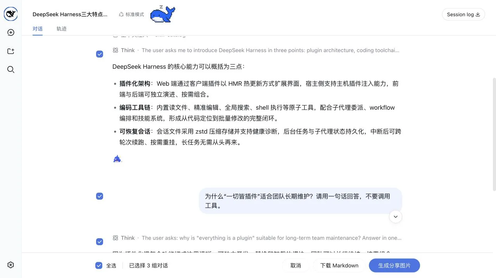
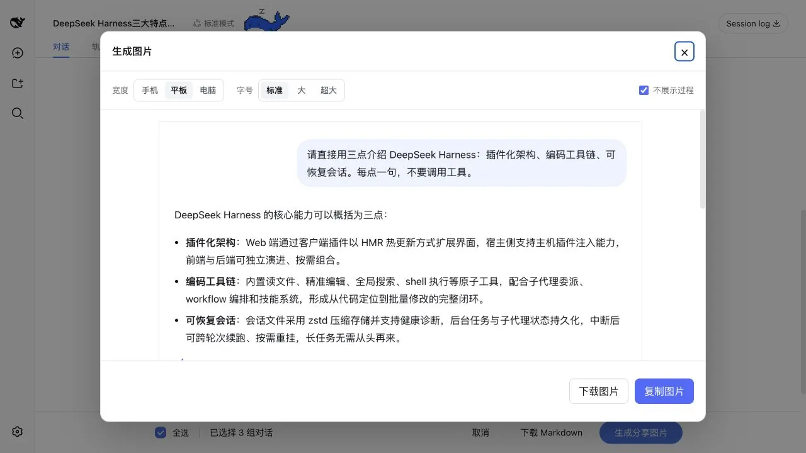

# dsh-share

简体中文 | [English](./README.en.md)

DSH 对话分享插件，分享单轮或多轮对话，可导出为图片或 Markdown。

和 DeepSeek 网页端一致的多选交互，操作体验完全一致。



生成图片前可调整宽度、字号和过程显示，完成后可下载或复制图片。



## 功能

- 从右上角进入问答选择模式，默认全选
- 每轮的分享按钮也会进入选择模式，并只预选当前问答
- 问题和回答两侧都有联动勾选框，也可直接点击内容整组选择，支持不连续选择
- 勾选框会在长内容滚动时吸附在页面上，到当前问题或回答末尾再移出
- 可复制图片、下载 PNG 或 Markdown
- 保留 Markdown、代码块、表格、图片和工具调用摘要
- 可调整图片宽度和字号，长图支持滚动预览
- 按完整问答顺序分页：当前页不足 4096 CSS 像素时继续加入下一整组，达到或超过目标后再换页。支持翻页预览、复制和下载当前页，以及下载全部分页 PNG；批量下载按页码命名，浏览器可能要求允许多个文件下载，桌面端可能逐个提示保存。末尾仅含一组且低于 1024 CSS 像素的短页并入前页，总共只选一组时保留单页。页面允许超过目标高度，不裁切内容
- 默认以 2 倍比例导出；图片过大或生成失败时，会尝试降低到 1 倍或 0.5 倍以保留完整内容。仍无法生成时明确提示失败，可减小字号、减少内容或导出 Markdown
- 可勾选“不展示过程”，只保留提问和最终回答

性能测试：日常聊天仅保留分享按钮等轻量开销；选择处理和图片生成只在使用分享功能时启动，并针对多轮对话做了优化。

## 快速安装

使用 DSH CLI 把插件加入 Web Profile，然后重启 `dsh web`：

```sh
dsh plugin --profile web add dsh-share
```

## 其他安装方式

安装指定的 GitHub 版本：

```sh
dsh plugin --profile web add github:hellodigua/dsh-share#vX.Y.Z
```

安装本地源码：

```sh
dsh plugin --profile web add /absolute/path/to/dsh-share
```

修改源码后，先运行 `corepack pnpm build`，再使用 `dsh plugin --profile web add --force /absolute/path/to/dsh-share` 刷新插件。

## 开发

项目不依赖本机 DSH checkout 即可安装依赖、运行测试和构建：

```sh
corepack pnpm install --frozen-lockfile
corepack pnpm typecheck
corepack pnpm test
corepack pnpm build
```

也可以用一条命令执行完整检查：

```sh
corepack pnpm verify
```

`lib/` 是 DSH 直接加载的交付物，需要和源码一起提交。修改 `src/` 后，请重新构建并确认 `lib/` 已同步更新。

发布前使用 `corepack pnpm release:check` 校验 npm 包边界，GitHub → npm 的自动化约定见 [RELEASING.md](https://github.com/hellodigua/dsh-share/blob/main/RELEASING.md)。

## 兼容性

开发基线为 `@deepseek-ai/dsh 0.2.0-rc.2`，运行时依赖范围为 `^0.1.7-rc.2 || ^0.2.0-rc.2`。分享入口使用官方 `conversation.chat.assistant-actions` 和 `conversation.session.header.utilities` 插槽，不扫描或修改按钮栏 DOM。多选模式通过 `data-chat-flow-kind` 等稳定的 `data-*` 属性添加选择框，不依赖 CSS Module 生成的类名；DSH 调整对话结构后可能需要同步适配。

## 已知限制

- 复制图片需要浏览器授予剪贴板权限，权限不足时仍可下载图片。
- 无法读取的远程资源会以透明占位跳过。
- 只能选择页面已经加载的完整问答；需要更早内容时，请先向上滚动加载。

## License

项目使用 [MIT](LICENSE) 许可证。浏览器 bundle 内联依赖的许可证见 [THIRD_PARTY_LICENSES.md](THIRD_PARTY_LICENSES.md)。

## 友情链接

已加入 [dshfind.com](https://dshfind.com) DSH 插件超市。
